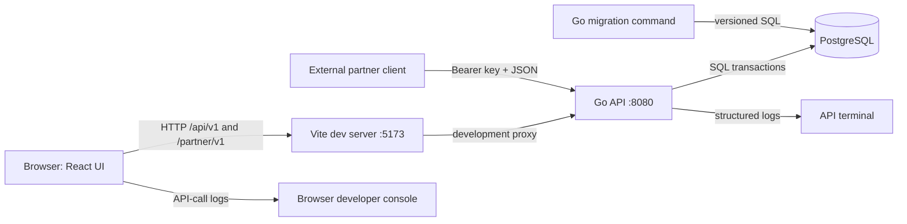

# How the application works

## What this is

This is a local proof of concept for registering purchases, physical products and ownership history. It has a browser interface, a Go HTTP API and a PostgreSQL database. The API can accept an order before any products are known, then attach products later.

**Demo only:** the admin and party interfaces do not authenticate users, and partner keys are stored and returned in plaintext. Do not expose this application to untrusted networks or use real personal data. The party dropdown is a way to choose a profile to inspect, not a secure login.

## Components and communication



1. The **React/TypeScript frontend** renders the admin, party and API-console views. During development, Vite serves it on port 5173.
2. Vite forwards browser requests beginning `/api` and `/partner` to the Go API at `127.0.0.1:8080`. This is a development-server configuration, not a production deployment setup.
3. The **Go API** authenticates partner requests, validates JSON, executes business rules and reads/writes PostgreSQL.
4. **PostgreSQL** stores profiles, purchase events, product data, ownership events, audit and outbox records. The migration command updates its schema separately; starting the API does not apply migrations.

Accepted order and product-addition operations are also logged in the API
terminal with their event ID, authenticated partner and correlation ID.
An idempotent retry produces another operation log but does not create another
database event. Request bodies, buyer references and credentials are not logged.

The Go API does not serve the built React files. `npm run build` produces frontend files under `frontend/dist`; a production hosting/proxy setup is not included.

## What each screen does

### Admin

- **Overview:** requests counts of partners, party profiles, purchases and product instances.
- **Create partner:** saves a partner identifier and name, generates a key, and displays it. The API console can select this partner and use its key.
- **Create/update party profile:** saves a person or organization with a display ID and comma-separated aliases. Selecting a profile in the list loads it into the form; saving replaces its alias list.

These are demo admin operations, not protected administrative access. Alias values belong to the party profile, not to a partner.

### My account

The dropdown selects a party profile. The API matches that profile's aliases against buyer identities from purchase events and returns purchases and their linked products, amounts and identifiers. An order without products is still shown. The screen does not authenticate the selected person and is a purchase-history view, not a secure current-ownership view.

### API console

Choose an endpoint and partner, fill in the JSON template and submit it. The selected partner's key is put into the `Authorization` header. The console displays the HTTP response and explains required and optional fields. It is a custom API console, not Swagger UI; its endpoint descriptions and templates are supplied by the Go API and are maintained separately from the OpenAPI file.

For creating an order, `products` starts as an empty list. A product example is available in the console when needed. See the [partner API guide](partner-api.md) for complete examples, accepted fields, totals and error responses.

## Walk through an order

1. In **Admin**, create a partner and a party profile. Add an alias that will be used as the buyer's external ID, such as `buyer-42`.
2. In **API console**, select `POST /partner/v1/orders` and that partner. Supply the order reference, time, buyer, seller, currency, total and VAT. The order can be sent with `products: []`.
3. The Go API checks the bearer key, decodes and validates the request, and calculates an idempotency hash from the normalized content.
4. In one transaction, the store resolves buyer/seller identities, records the purchase and any products, adds ownership and resource records where applicable, saves the response, and writes audit and outbox events. An error rolls back the transaction.
5. The partner receives `202 Accepted`. Retrying the same normalized order under the same partner and `order_ref` returns the saved response; different content under that reference returns `409`.
6. To add products later, submit `POST /partner/v1/orders/{order_ref}/products` using a new partner-unique `event_ref`. The API locks the order while checking cumulative amounts, and records the addition transactionally. Partial additions are allowed within the order totals. Legacy orders without totals cannot be checked against an absent total.
7. Open **My account** and select the profile. Its alias is matched against buyer identities to find the purchase. Without a matching alias, that purchase will not appear.

For the actual tables and the distinction between profiles and incoming identities, see the [database model](database-model.md).

## Source map

| Location | Responsibility |
| --- | --- |
| [`frontend/src/App.tsx`](../frontend/src/App.tsx) | Screens, API calls and console. |
| [`frontend/vite.config.ts`](../frontend/vite.config.ts) | Development server and API proxy. |
| [`cmd/api/main.go`](../cmd/api/main.go) | API process configuration, database pool, HTTP server and shutdown. |
| [`cmd/migrate/main.go`](../cmd/migrate/main.go) | Standalone migration command. |
| [`internal/httpapi/server.go`](../internal/httpapi/server.go) | Routes, partner authentication, HTTP responses and demo profile endpoints. |
| [`internal/orders`](../internal/orders/) | Request types, normalization and validation, including exact decimal amount rules. |
| [`internal/store`](../internal/store/) | PostgreSQL transactions for orders, products, ownership, audit and outbox. |
| [`internal/migrate`](../internal/migrate/) | Embedded, ordered SQL migrations and runner. |
| [`openapi/openapi.yaml`](../openapi/openapi.yaml) | Partner API contract; [partner-api.md](partner-api.md) explains it in plain language. |
| [`docs/adr`](adr/) | Architecture decision records. |

## Run and build locally

Requirements: Go 1.23+, PostgreSQL 13+, and Node.js/npm for the frontend. Create a PostgreSQL database and set `DATABASE_URL` and a stable, random `PARTY_ID_HMAC_KEY` of at least 32 bytes in the API terminal. `PARTNER_ID` and `PARTNER_API_KEY` provide an optional configured partner credential; the admin screen can create database-backed partners. Keep secrets out of source control. See the [README](../README.md#configure-and-run) for the environment-variable names.

In the repository root, apply migrations and run the API:

```powershell
go mod download
go run ./cmd/migrate
go run ./cmd/api
```

In another terminal:

```powershell
cd frontend
npm install
npm run dev
```

Open `http://localhost:5173`. The Go API defaults to `http://localhost:8080`; `HTTP_ADDR` changes the API listener, but the development proxy must also be updated if its destination changes.

To check or build:

```powershell
go test ./...
go vet ./...
cd frontend
npm run build
npm run lint
```

Run the Go commands from the repository root and the npm commands from `frontend`. Database integration tests need `TEST_DATABASE_URL` pointing to a dedicated test database; without it those tests skip. CI provides PostgreSQL and runs the Go tests and vet.

## Troubleshooting and current boundaries

- **API response is 401:** select the intended partner and use its key. A configured `PARTNER_ID`/`PARTNER_API_KEY` pair is also supported.
- **API response is 400:** inspect the response `detail`. For a new order or an addition to an order with amounts, every supplied product needs a valid identifier, total and VAT. Omit products or use `[]` when creating an order without products.
- **No purchases for a profile:** ensure a profile alias exactly matches the buyer external ID used in the event and that the HMAC key has not changed.
- **Find a request:** the browser developer console logs API method, route, status, duration and correlation ID. The API terminal logs the corresponding structured request. Bodies and keys are not intentionally logged.
- `GET /health` checks API liveness; `GET /ready` checks database connectivity on the Go API. The Vite proxy currently forwards `/api` and `/partner`, not those health paths.
- `audit_events` and `outbox_events` are recorded, but there is no webhook delivery worker. External resource links are stored, not resolved or downloaded.
- Product GTIN-plus-serial identity enforcement, ownership transfer, authenticated user access and production TLS are not implemented. Profile and partner administration is not an append-only event history.
