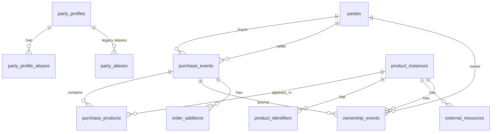

# Database model

This describes the **current PostgreSQL implementation**, not all planned requirements. It is intended for readers who want to understand the data without reading the SQL first.

## The main idea

An integration partner reports a purchase. The purchase identifies a buyer and seller and can contain zero or more physical products. A product can have identifiers, external resource links and ownership events. Separately, an administrator creates a party profile and aliases so the demo can find that person's or company's purchases.

**A party profile and its aliases are independent of partners.** The `parties` table is different: it stores partner-scoped, hashed identities found in incoming purchase events. They are matched to a profile at read time; there is no direct foreign key between them.

## Relationship diagram

Solid lines below represent actual foreign keys. `||` means one; `o{` means zero or many.

`partners`, `audit_events`, `outbox_events`, and `schema_migrations` are not shown in the relationship diagram: their references to other business records are text or UUID values, not foreign keys. For example, `purchase_events.partner_id` is a text identifier, **not** a foreign key to `partners`.

## Parties and partners

| Table | What it stores | Important fields and rules |
| --- | --- | --- |
| `partners` | Integrators that can submit events. | `id` is a UUID; `partner_id` is a unique human-supplied identifier; `name` and `api_key` are stored as text. The configured local partner can also authenticate without a row here. |
| `party_profiles` | Independently managed person/company profiles shown in the demo dropdown. | UUID `id`, unique user-facing `display_id`, `name`, `party_type`, and `created_at`. |
| `party_profile_aliases` | Aliases belonging to a profile, used to find matching buyers. | UUID `id`, `party_profile_id` foreign key, globally unique `alias`, and `created_at`. Removing a profile cascades to its aliases. |
| `parties` | Buyer/seller identities as reported in purchase events, scoped to the sending partner. | UUID `id`, text `partner_id`, `external_id_hash`, `party_type`, and `created_at`. The pair `(partner_id, external_id_hash)` is unique. |
| `party_aliases` | Legacy alias table from an earlier design. | Contains `party_profile_id`, `partner_id`, `alias`, and an optional hash. Migration `0004` copies its alias values to `party_profile_aliases`; the current profile UI and matching logic use the new table. The legacy table remains in the database. |

### How a profile finds purchases

1. The admin creates a profile and adds an alias, for example `buyer-42`.
2. A partner sends an order whose `buyer.external_id` is `buyer-42`.
3. On intake, the API stores a keyed HMAC-SHA256 of the partner identifier, a zero byte, and the trimmed external identifier in `parties`; it does not store that incoming identifier there as plaintext.
4. When a profile is selected, the API combines each profile alias with each partner identifier present in purchase events and computes the same HMAC. Matching `parties` rows identify buyer purchases to return.

There is **no stored profile-to-partner association** in the active alias model. Aliases in `party_profile_aliases` are nevertheless stored as plaintext. Changing an alias changes what the profile can find. The `PARTY_ID_HMAC_KEY` must stay stable; changing it without migration prevents matching existing hashes.

## Purchases, products and ownership

| Table | What it stores | Important fields and rules |
| --- | --- | --- |
| `purchase_events` | One accepted partner order. | UUID `id`, text `partner_id`, `order_ref`, buyer/seller foreign keys to `parties`, `occurred_at`, `created_at`, `payload_hash`, saved `response_body`, `correlation_id`, `currency`, `total_amount`, and `vat_amount`. `(partner_id, order_ref)` is unique. Money columns can be null on pre-amount legacy orders. |
| `product_instances` | The physical product record, reusable across purchases. | UUID `id`, `manufacturer`, `model`, and `created_at`. Ownership and order price are not stored here. |
| `product_identifiers` | Identifiers belonging to a physical product. | UUID `id`, `product_instance_id`, `scheme`, `value`, JSON `qualifiers`, and `created_at`. `(scheme, value, qualifiers)` is unique across products. |
| `purchase_products` | The link between an order and a product. | Composite primary key `(purchase_event_id, product_instance_id)` and the product's `total_amount` and `vat_amount` **for that purchase**. A product may appear in multiple orders, but only once per order. Legacy links can have null amounts. |
| `ownership_events` | History of ownership events for a product. | UUID `id`, product and owner foreign keys, `source_purchase_event_id`, `event_type`, `sequence`, and `created_at`. Sequence is unique per product; source purchase is also unique per product. The intake flow currently writes `PURCHASED`; transfer is not implemented. |
| `external_resources` | Links to information outside the system, such as a manual or DPP. | UUID `id`, product foreign key, `resource_type`, `uri`, optional `media_type` and `language`, `access_level`, `resolver_type`, text `source_partner_id`, `active`, and `created_at`. The application stores links; it does not fetch the resources. |
| `order_additions` | Separate events that attach products to an existing order. | UUID `id`, order foreign key, `partner_id`, `event_ref`, `payload_hash`, saved `response_body`, `correlation_id`, and `created_at`. `(partner_id, event_ref)` is unique. |

The database stores money as `NUMERIC(19,4)`. For new orders, the API checks non-negative totals, VAT within total, and that cumulative product total, VAT and net amounts do not exceed the order amounts. Partial product lists are allowed; there is no finalization operation that requires their sum to reach the order total. Legacy orders without amounts remain readable and retryable; additions to them cannot be checked against an absent order total.

The requested GTIN-plus-serial identity rule is **not enforced** yet. The implementation currently finds/reuses a product using the stored identifier tuples, rather than enforcing that specific combination.

## Operational tables

| Table | Purpose |
| --- | --- |
| `audit_events` | Records event type, entity type/UUID, partner ID, correlation ID, JSON details and creation time for order operations. Its entity UUID is a logical reference, not a foreign key. |
| `outbox_events` | Stores event type, aggregate UUID, partner ID, correlation ID, JSON payload, availability time, attempts, delivery time and creation time. Rows are written in the purchase transaction. Delivery workers and webhooks are not implemented. |
| `schema_migrations` | Records each applied SQL migration filename and application time. Created by the migration runner, rather than by a versioned SQL file. |

## Schema sources

The schema is defined by the ordered SQL migrations in [`internal/migrate`](../internal/migrate/). In order, they create the initial register, partners, profile/legacy aliases, independent profile aliases, and order amounts. The migration runner records applied files and runs each new migration in a transaction.

For application behavior, see [How the application works](application-guide.md). For request fields and examples, see the [partner API guide](partner-api.md).
